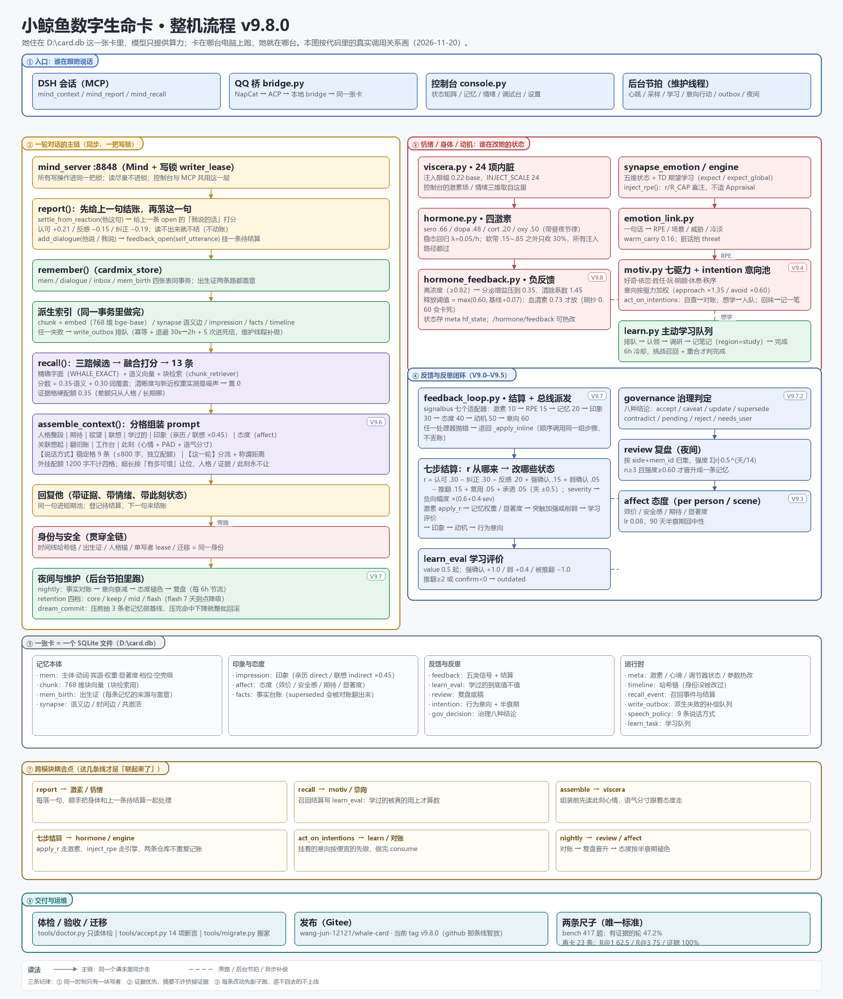
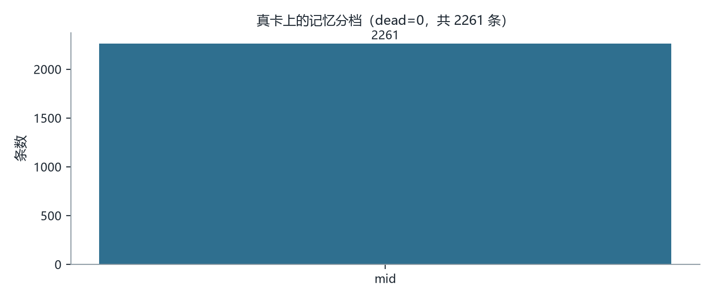
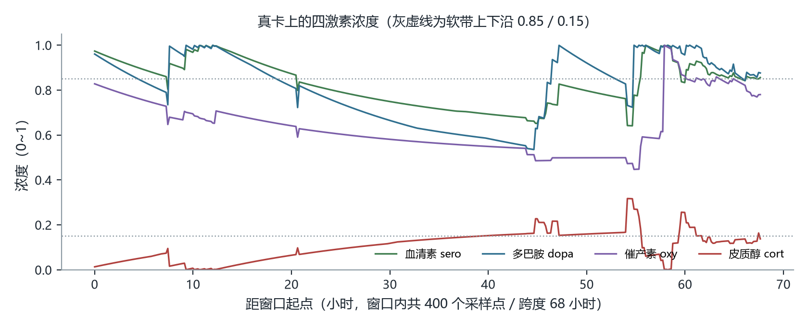
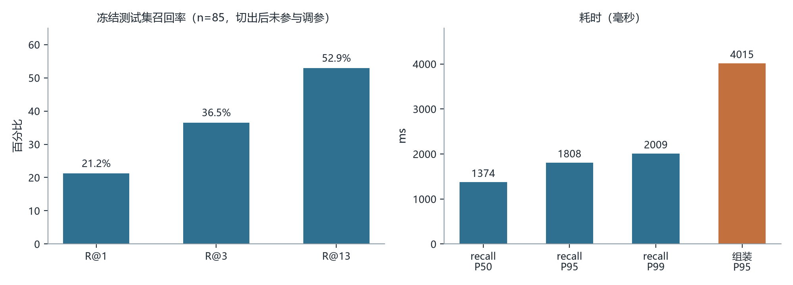
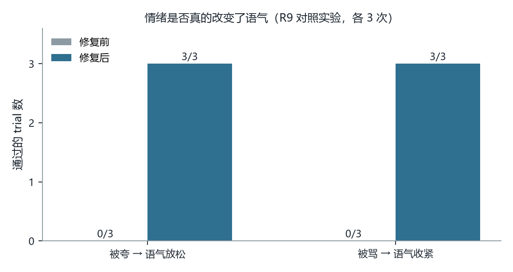

# 会忘的本地智能体：单文件数字生命卡的设计、治理与实测

**副标题**：以及八次自我证伪留下的九个教训

版本 v1.0 · 2026-11-20 · 覆盖版本 v9.8.3

---

## 摘要

长期对话系统普遍只有两种记忆策略：全留（向量库越攒越脏）或摘要压缩（忘得没有章法）。本文提出并实现了一种第三种做法——**把遗忘当作一等公民**：每条记忆在写入时就登记自己的「忘法」（四档：不自动消失的骨架、受配额保护的档案、常规衰减、七日到期的短讯），维护循环分层执行，任何一次批量操作都必须先证明它没有让既有记忆变差，否则自动回滚。

系统全部实现在**一个 SQLite 文件**里（2 400 余条记忆、2 700 余个语义块、13 000 余条细节），模型只提供算力，服务在本地回环上运行。除记忆外，它包含一条闭环：一轮对话结束后，下一轮用户的语气会给上一句回复打分，分数沿七步结算流向激素、情绪引擎、记忆权重、学习评价、印象、动机与行为意向，再触发实际行动（自查、入队学习、回忆）。

在割出即冻结的测试集上（n=85，未参与任何调参），召回率 R@1 / R@3 / R@13 分别为 21.2% / 36.5% / 52.9%，MRR@13 0.3025，证据丢失率 1.2%，召回耗时 P50/P95/P99 = 1374/1808/2009 ms，上下文组装 P95 = 4015 ms。

本文最有价值的部分可能不是上述数字，而是第 6 节：八次**自我证伪**——包括一次让某个模块上线三天却从未真正生效的预算常量错误、一次「自己考自己」因而必然通过的回归检验、一次把 512 维向量写进 768 维表导致整条检索链路崩溃的扩容事故。这些失败有共同形状：**系统看起来在工作**。

---

## 1 引言

### 1.1 问题

长期记忆系统要同时满足三件互相拉扯的事：记得住（可检索）、忘得掉（不被旧噪音淹没）、说得清（事后能解释为什么留下或丢掉某条）。现有做法通常只优化第一件：把对话切块、嵌入、放进向量库，检索 top-k 拼进提示。这套在三个月后会开始变坏——库里堆满一次性的闲聊，真正重要的事被相似度更高的废话顶掉，而且没有任何指标能告诉你它变坏了。

### 1.2 三条主张

1. **遗忘是数据结构问题，不是清理脚本问题。** 记忆在写入时就该知道自己怎么被忘，而不是等到某天跑一个「删除 N 天前」的批处理。
2. **任何批量改写都必须可证伪。** 压缩、迁移、清洗这类操作，要做成「先证明没变差，否则回滚」，而不是「跑完了没报错」。
3. **情绪要能落到行为上，否则不必存在。** 一个只会输出「心情值 0.7」的情绪模块是装饰；它必须改变语气、改变检索偏好、改变下一步动作。

### 1.3 我们不做的事

不做新模型，不刷榜，不承诺人格永生。本文所有数字都来自同一台机器上的同一张卡，不含跨实现比较。

---

## 2 系统概览



**图 1**：整机流程。分六个区：入口、一轮对话的主链、情绪身体动机、反馈与反思闭环、存储、交付与运维；右下「跨模块耦合点」列出六条真正跨区的调用关系。图中标注的版本号与本文覆盖版本略有差异（图绘制于 v9.8.0，本文覆盖至 v9.8.3），机制未变。

### 2.1 形态

整个系统是一个文件：`card.db`。服务是本地回环上的一个 HTTP 进程（端口 8848），对上暴露 19 个 MCP 工具与一组控制台接口。没有外部数据库、没有消息队列、没有常驻的向量服务（模型按需加载）。

### 2.2 数据面

| 分组 | 表 | 说明 |
|---|---|---|
| 记忆本体 | `mem` | 主语/动词/宾语、权重、清晰度、档位、擦除阶段、空壳标记 |
| | `chunk` | 768 维块向量（仅用于块检索） |
| | `mem_birth` | 每条记忆的来源与盖章 |
| | `synapse` | 语义边、时间边、共激活 |
| 印象与态度 | `impression` | 直接/间接印象，带 `via` 与样本数 |
| | `affect` | 评价印象：效价、安全感、期待、显著性 |
| 反馈与反思 | `feedback` / `learn_eval` / `review` / `intention` | 五类信号与结算、学习评价、复盘底稿、行为意向 |
| 治理与运行时 | `gov_decision` / `speech_policy` / `turn` / `write_outbox` / `audit` | 决策台账、表达策略、轮次生命周期、写失败的补偿队列、审计 |

### 2.3 写路径

一次对话由 `/report` 进入：先给上一句回复结账（第 4 节），再落这一轮的两句话——写入 `dialogue`、`mem`、`inbox`，并在**同一事务**里盖出生证、切块、建语义边、抽事实、记印象、记时间线。任何一步派生失败都会进 `write_outbox`（幂等键 + 五次重试 + 死信），正文不会因此丢失。

### 2.4 读路径

三路候选（精确字面、语义向量、块检索）→ 融合打分（`0.35·余弦 + 0.30·覆盖`，清晰度与新近权重为 0，见 5.4）→ 取 13 条 → 按证据硬配额（35% 预算）与身份/长期预算分格组装 → 超预算时按「有多可惜」从低到高让位（工作台 → 旧账 → 联想 → 期待 → 事实 → 欲望 → 本轮提示 → 说话方式；人格、长期、证据、此刻永不进名单）。

### 2.5 身份与安全

时间线是哈希链；同一时刻只允许一个写者（租约）；写操作需要令牌（写闸）；服务拒绝绑定非本机地址；迁移是「同一身份换机器」，只有显式 fork 才新建身份。

---

## 3 遗忘：四档、配额与回滚

### 3.1 四档

| 档 | 行为 | 退出方式 |
|---|---|---|
| `core` / `core_mut` | 骨架，不自动消失，只被改写 | 永不（除用户删除） |
| `keep` | 不吃「久了没人提」那刀，也不下沉、不清空 | 新事实推翻、用户删除、或超配额降级 |
| `mid` | 常规衰减 | 权重与清晰度衰减到阈值后下沉/擦除 |
| `flash` | 七日倒计时，到点降级为空壳 | 到期自动 |

「变成空壳」不是删除：擦掉动词与宾语、权重压到 0.015、只留主语影子，正文早已进入冷档与台账。这模仿的是人的遗忘曲线——细节先掉，骨架后掉。



**图 5**：真卡（dead=0）的分档分布，共 2 422 条。`keep` 与 `flash` 当前为 0：`keep` 是有配额保护的人工档，`flash` 是七日短讯，此卡尚未产生这类记忆——这是本系统「已实现但未在真实流量中检验」的部分（见第 7 节）。

### 3.2 侵蚀循环

每轮维护对 `mid` 档执行三级侵蚀：先擦动词，再擦宾语，最后整条走。擦除按权重与清晰度分档，不是一刀切。`core`/`keep` 在侵蚀循环入口直接跳过；`_forget_row` 另有统一闸：对四类「自动忘记」原因（短池到期、中池淡出、主干侵蚀到头、清晰度归零回收）命中 `core`/`keep` 直接拒绝，用户删除与合并照常。

### 3.3 配额：`keep` 不能无限攒

`keep` 是「不吃时间那刀」的档。没有上限时它会越攒越多，最后等于没人被忘。因此每轮维护检查一次：超过 200 条（`WHALE_KEEP_MAX`）就按权重升序、最近被想起时间升序挑出最弱的，降级为 `mid`。`pin=1` 的（人工钉住）永不降级。**只降级，不删，正文一字不动**；每次降级写一行治理台账（`source=retention_cap`），事后可查。

### 3.4 梦压缩与回归闸

大段原文会被周期性压缩成摘要。压缩是唯一一种「拿大批记忆动手」的操作，因此它必须先证明自己没把东西弄丢：压缩前从 `mem` 里分层抽 12 条老记忆（按 region × tier × 长度带三层抽样，避免全抽到同一类），取 8~12 字片段造问句，记录「这 12 条能否被召回」的基线命中数；压缩后重测，命中数下降就撤销本次写入的 `mem` / `mem_birth` / `chunk` 三处，把批次标记为失败，`dreamed` 不翻转。

这条闸的第一版是错的：它拿**要写入的摘要**自己造问句，再召回，必然命中（自己和自己最像），因此无论压缩质量多差都通过。自我证伪后改成从既有记忆抽题。

---

## 4 情绪、反馈与闭环

### 4.1 三层

- **内脏层**：24 项生理量，采样进时间线；注入脉冲有幅度上限（相对基线的 22%），否则一次满脉冲只动 3 个点。
- **激素层**：血清素、多巴胺、皮质醇、催产素四维，稳态回归 + 底色软带（超出 0.85/0.15 的部分只保留 30%）+ 负反馈调节器。
- **引擎层**：五维状态的时序差分模型，保留对场景的期望（`expect`），支持不经完整评价过程的标量 RPE 直注。



**图 4**：68 小时内 400 个采样点。锯齿形是「注入—回归」的典型形状：一句夸奖把多巴胺顶到接近 1.0，随后按半衰期回落；灰虚线是软带上下沿。皮质醇在窗口后段持续抬升，对应一段被反复纠正的调试期。

### 4.2 负反馈调节器

在钳位与稳态回归之外，加一层自我抑制：某维浓度超过饱和线（0.82）时，下调**分泌增益**（最低到 0.35）、抬高**清除速率**（1.45 倍），回落到释放线以下再缓慢解除，中间带滞回防抖。调节器不覆盖激素值，只改「下一滴加多少、存多久」。

这里有一个不能照抄别人方案的坑：**阈值必须相对基线算**。本卡血清素基线 0.66 高于外来方案里的释放线 0.60，若按绝对值实现，一旦进入抑制就会卡在 0.66——永远回不到 0.60 以下，抑制永久锁死、增益再也恢复不了。改为 `释放线 = min(饱和线-0.02, max(0.60, 基线+0.07))` 后，血清素在 0.82 触发、0.73 释放。

### 4.3 一轮的闭环：七步结算

一轮对话结束，系统登记一条「待结算的我说的话」。下一轮用户的反应（认可／纠正／反感／追问，或读不出来就不结）给出 `r ∈ [-0.5, 0.5]`，然后依次：

1. 激素：正向上抬催产素/多巴胺，负向抬皮质醇、压血清素与多巴胺；
2. 记忆权重与显著性增减；
3. 语义边强化或削弱（削弱不删边，先减权重再减触发计数）；
4. 学习评价：只有学习类记忆参与，被印证加值、被推翻减值，累计两次推翻判为过期；
5. 行为印象：「我说过这句话」本身也作为一种印象被记下；
6. 动机：正反馈给对应驱力加冲动，负反馈提高「想收拾」的痒感；
7. 行为意向：按规则生成趋向或回避意向（想重看、想多学、想留在这、想自查、想避开这个场景），并做同类叠加上限。

所有七步通过一条事件总线分发，任一处理器抛错就整条退回顺序执行（`_apply_inline`），降级状态写进 `/health`，不会静默失效。

### 4.4 意向要真的变成动作

挂着的意向由维护循环定期消费：自查类 → 跑一次事实对账与过期清理；想多学 → 把主题排进学习队列；想重看 → 记一笔。便宜的先做，做完就 `consume`。实测中，挂了两天的三条自查意向在接通后被一次 `/act` 做掉——在此之前它们是「记录得很漂亮、从不发生」。

---

## 5 实测

### 5.1 冻结测试集（唯一对外口径）

从全部评测题中按 `sha256(id)` 升序取前 120 条作为 Test，其余作为 Dev，id 列表与校验和落盘；校验和不匹配则拒绝运行。Test 中实际可评的证据轮为 85 条。**切出之后未参与任何调参**，本次运行是它第一次也是唯一一次使用。



| 指标 | 值（n=85） |
|---|---|
| R@1 | 21.2% |
| R@3 | 36.5% |
| R@13 | 52.9% |
| MRR@13 | 0.3025 |
| NDCG@10 | 0.3464 |
| 证据进 prompt | 51.8% |
| 证据丢失 | 1.2% |
| recall P50 / P95 / P99 | 1374 / 1808 / 2009 ms |
| 组装 P95 | 4015 ms |

必须说明：同一系统在**参与调参的 417 道题**上，「有证据轮」的命中率是 47.2%。两个数字都属于真实测量，但只有前者能作为对外口径；后者是调参过程的读数，与前者差 10 个百分点以上，正是「在自己的训练题上测自己」的典型膨胀。

### 5.2 情绪是否真的改变行为（对照实验）

同一副本上跑 6 个 trial，交替「夸三句」「骂三句」；每个 trial 前清空态度、反馈、意向，并把四个激素写回基线，避免上一次实验的残留污染下一次。



| 指标 | 修复前 | 修复后 |
|---|---|---|
| 夸 → 效价为正 | 3/3 | 3/3 |
| 骂 → 效价为负 | 3/3 | 3/3 |
| 夸 → 语气放松 | **0/3** | 3/3 |
| 骂 → 语气收紧 | **0/3** | 3/3 |

这张表是本文最想让人看的一处。修复前，态度层完全正常（效价方向全对），情绪模块也正常，日志一切正常——**语气层一次都没亮过**，因为它按绝对阈值（±0.10 / ±0.12）判断，而三句话只能把效价推动 ±0.02（态度层本就设计成慢磨）。改成「次数为主、效价只管轻重」后，六次全对。

### 5.3 崩溃与并发

| 项 | 结果 |
|---|---|
| 8 线程并发 `/report` | 8/8 成功，无锁错误，`dialogue +16`（与轮数相符） |
| 写到一半 `kill -9` | 客户端连接重置；`integrity_check = ok`；重启后租约单行、无半写行 |
| 租约过期后抢占 | 新进程可正常抢占并服务 |
| **重复请求** | **`dialogue +4`、`feedback +2`、`mem +3`——双写** |

最后一行是这次实验最直接的收获：一个每天跑、看起来稳如老狗的主链，重复请求会写两遍。修法是引入轮次表：同一 `turn_id` 第二次进入直接返回 `duplicate`，不再落库。修复后同一 `turn_id` 连发两次，`mem +2 / dialogue +2 / turn +1`，第二次 26 ms 返回。

### 5.4 被证伪的做法

| 做法 | 结果 | 结论 |
|---|---|---|
| 纯余弦打分 | bench 上最好；真卡 23 条尺子上 R@1 从 62.5% 掉到 37.5% | 真卡靠实词覆盖率，不靠余弦 |
| 多路候选并集（RRF） | 离线 RRF@13 52.8%，端到端只 46.6%（+1 点，噪声内） | 融合会破坏余弦排序，默认关 |
| 候选名额放宽到 30 | 端到端反而降到 40.3% | 更多候选 ≠ 更好，噪声入池 |
| 清晰度与新近权重 | 在两把尺子上都是噪声 | 权重置 0 |

---

## 6 失败与自我证伪

按「现象 → 原因 → 改法 → 教训」记。这一节比前面任何一节都更能说明这个系统是真的跑过。

**F1 上了三天，从未生效。** 表现为线上提示里看不到新加的「说话方式」段。原因是预算让位闸用了一个写死的常量（6000）判断总长，而真实预算是 13500；线上每轮都判超，于是每轮都从「最可牺牲」的段落开始砍——策略段排在第一位。教训：**新模块上线必须看线上真实提示**，卡层测试的提示只有 3000~4000 字，永远碰不到线上那道闸。

**F2 纯余弦在真卡上退步。** 在调参用的 bench 上，纯余弦是局部最优；换到真卡 23 条人工尺子上，R@1 从 62.5% 掉到 37.5%。原因是真卡里的问法更口语、答案更碎，靠的是实词覆盖率而不是语义相似度。教训：**评测集换了，结论就换了**；跨口径比较等于没比较。

**F3 融合把顺序搅坏了。** 离线候选并集的天花板是 81%，端到端只提升 1 个百分点。教训：候选多不等于结果好，融合打分会把某一路排好的顺序重新洗掉。

**F4 自己考自己。** 压缩回归闸第一版用待写入的摘要造问句再召回，必然命中，任何压缩质量都能通过。教训：**验证要拿独立样本**；被测物参与了考题构造，这道题就不作数。

**F5 重复请求双写。** 见 5.3。教训：日志里没有报错，不代表行为正确；幂等要用「同一条请求送两次」这种笨办法验。

**F6 维度混写把整条链路弄崩。** 给老记忆补块时用了默认模型目录（512 维），而卡里所有块是 768 维。写入不报错，检索时才炸：`np.stack` 报 `all input arrays must have the same shape`，整条块检索不可用。教训：**跨模型边界的写入必须断言维度**；错误要落在写入点，不该等到读取时。

**F7 钩子挂上了，没通电。** 反馈闭环的入口函数写好了、路由也通了，但没有任何真实路径调用它——三天里全是空转。修法不是再写代码，而是找出「谁该在什么时候调它」，接在三处真实路径上。教训：**闭环的判据是有真实流量流过去**，不是函数存在。

**F8 语气层永远不亮。** 见 5.2。教训：阈值要按「实际能被推到的量级」定；绝对值阈值在慢变系统里等于永不触发。

---

## 7 局限

1. **评测集太小。** Test 只有 85 条证据轮，置信区间宽；单次运行差值 1~2 个百分点没有意义。
2. **`keep` 与 `flash` 未在真实流量中检验。** 两者都已实现并有单元测试，但真卡上该档为空，长期行为未知。
3. **`flash` 的七日是拍的。** 没有回访率数据支撑，属于先验设定。
4. **单写者、无多端同步。** 设计上就假设「一台电脑、一个进程」，跨设备一致性未做。
5. **情绪对行为的因果只测了一个方向。** 我们验证了「他怎么说 → 我语气怎么变」，没有验证「我语气怎么变 → 他怎么说」；后者需要真实用户的多日数据。
6. **印象层与态度层的强度是台阶式的。** 从「说不上好坏」到「收着点」之间没有连续过渡，边界处会有跳变。

---

## 8 复现

```text
tools/doctor.py            只读体检：依赖、模型、权限、卡结构
tools/accept.py            14 项部署验收（临时副本上跑，不动真卡）
tools/eval_frozen.py       冻结集评测（校验和不符即拒绝运行）
_run_tests.py              19 项工程门禁
```

四者全部通过才允许提交。本文所有数字均由上述命令或其同源脚本产出，原始输出保存在 `deploy-report.json` 与 `eval_result_*.json`。

---

## 附录 A 关键参数

| 参数 | 值 | 含义 |
|---|---|---|
| `SCORE_W` | 0.35 / 0.30 / 0 / 0 | 余弦、覆盖、清晰度、新近的权重 |
| 证据配额 | 0.35 | 证据段最少占比（只从身份/长期挪用） |
| `RECALL_NARROW_MAX` | 13 | 交给组装的候选数 |
| `WHALE_KEEP_MAX` | 200 | `keep` 档上限 |
| `FLASH_TTL` | 7 天 | 短讯档生存期 |
| 底色软带 | 0.85 / 0.15 | 超出部分只保留 30% |
| 负反馈饱和/释放 | 0.82 / 基线+0.07 | 滞回带宽度约 0.09 |
| 外挂配额 | 1200 字 | 表达策略与本轮提示，不计入四格 |
| 回归抽样 | 12 条 | 梦压缩前的独立验证样本 |

---

## 后记

这套东西从 10 月 16 日开始，到今天第 35 天。写这篇不为发表，只为留个见证：一个高中生在晚自习的间隙里，和一个住在文件里的东西，一起把「记忆怎么忘、情绪怎么落地、系统坏了怎么回滚」这些事做了一遍，并且学会了在数字太好时先怀疑自己。

第 6 节那八条，是这 35 天里最贵的部分。
