# 记忆稳态：数字生命体中遗忘、情绪与自驱学习的耦合

**Memory Homeostasis: Coupling Forgetting, Affect and Self-Driven Learning in a Single-File Agent**

草稿 v0.8 · 2026-11-21 · 覆盖系统 v9.8.3

---

## 摘要

长期对话智能体的记忆策略通常只有两种：全留（向量库越攒越脏）或压缩（忘得没有章法）。本文提出并实现第三种做法——**把遗忘当作一等公民**：每条记忆在写入时登记自己的「忘法」，由保留分档、配额与侵蚀三级分层执行；同时把情绪实现为一组带负反馈的标量状态，让「被夸会暖、被冤枉会记」这类动力学**作用于记忆权重与语气**，而不是只写在提示词里；再让未被满足的行为意向驱动自主动作（自查、入队学习、回忆），最后给所有批量改写操作加一道**可证伪的回归闸**：在冻结样本上重跑召回，变差就自动回滚。

系统全部实现为一个 SQLite 文件（真卡 2 476 条记忆、2 700 余个语义块、13 000 余条细节），服务是本地回环上的单一 HTTP 进程，模型只提供算力。我们在真卡快照上做了四组对照实验。最重要的结果由两个负结果组成。其一，保留分档在一年尺度上只比均匀指数衰减多救 2 个百分点（17.2% vs 15.2% 可见），因为升级到保护档的门槛在真实使用中几乎不触发——全卡只有 3.4% 的记忆攒到「三个不同日子被想起」。其二，把衰减真的接到冻结集检索上之后，排序一动不动（R@1 23.5% 在所有时间点相同），只有「显示」在塌：证据仍可见的比例今天 14.1%、30 天 1.2%、90 天归零。合起来说明：**分档保证「不被删」，权重保证「还看得见」，但两者都不保证「被想起」；遗忘与检索目前是解耦的。**

本文的另一半价值在失败：我们把八类「看起来在工作、其实没工作」的失效形态写进了讨论，包括一次让新模块上线三天却从未生效的常量错误、一次「自己考自己」的假检验、一次把 512 维向量写进 768 维表导致整条检索链路崩溃的事故。

## 1 引言

长期记忆系统的主流做法是「检索增强」：把历史切成块、嵌入、按相似度取回若干条填进上下文。这条路解决了「记得住」，却回避了两个更难的问题：

1. **退场**。绝大多数记忆不会再被用到，但它们仍占空间、参与检索、制造冲突。堆到几万条时，召回质量下降不是因为它变笨了，而是因为噪声变多了。
2. **状态**。同一个人在被夸与被骂之后，该如何不同？多数系统把答案写在提示词里（「你现在有点难过」），但那只是台词。要让状态真正起作用，它必须能改变**记忆权重**和**下一次的说话方式**。

本文的主张有三条：

- **C1（结构性）**：遗忘应是写入时就登记的一等属性（分档 + 配额 + 侵蚀），而不是事后的清理脚本。「怎么忘」是数据结构问题，不是提示词问题。
- **C2（动力学）**：情绪不是台词，是一组带负反馈的标量状态；它必须能改变记忆权重与语气，否则等于不存在。
- **C3（可证伪性）**：任何批量改写记忆的操作（压缩、合并、侵蚀升级）都必须先在冻结样本上证明没有变差，否则自动回滚。

三条主张共同构成我们称之为「记忆稳态」的东西：不是把记忆攒得更多，而是让**保留、情绪、学习**三套机制在同一份状态上互相制约。

本文的贡献是：(i) 一个可运行的单文件实现（约 4 900 行服务 + 8 400 行卡逻辑）；(ii) 四组在真卡快照上的对照实验，含一个明确的负结果；(iii) 八类失效形态的复盘，供后来者对照。

## 2 背景与相关工作

| 线索 | 代表工作 | 与本系统的差别 |
|---|---|---|
| 遗忘曲线 / 间隔重复 | Ebbinghaus 1885；SM-2 | 它们描述**复习**；本文描述**不复习时如何退场**（分档 + 配额 + 侵蚀） |
| 稳态 | Cannon 1932 | 借用其「负反馈维持内环境」框架，落地为**分泌增益**与**清除速率**两个可调系数 |
| 奖赏预测误差 | Schultz, Dayan & Montague 1997 | 只借 RPE 作为结算标量，不建模神经机制；阈值按**基线**而非绝对值定 |
| 智能体记忆 | MemGPT / Generative Agents 一类 | 多聚焦「检索与反思」；本文聚焦「退场与配额」以及回滚闸 |
| 机器遗忘 | machine unlearning | 目标是**删除**以满足合规；本文目标是**降级**，保留可检索的骨架 |

本文刻意不做的三件事：不声称模拟大脑（激素是工程标量）；不声称意识或感受；不与「更大模型 + 更大上下文」正面竞争——我们竞争的是**同样算力下的长期一致性**。

### 2.1 与生物学的三层对照：只借形态，不借机制

这一节只做一件事：把我们的模块与教科书上的生物模块并排放，标明**哪里形状像、哪里机制不同**。三张图各自的结论一句话——神经元的并行结构与可塑性我们只模拟了「加权图 + 复用计数」（图 14）；内分泌的「阈值触发、滞回、缓慢解除」我们照搬了形态，但没有级联的器官链（图 15）；记忆分类我们只对应到存储时长，没有感觉记忆层（图 16）。这三条界线写在这里，是为了防止后面任何一句「模仿大脑」被读成更强的声明。

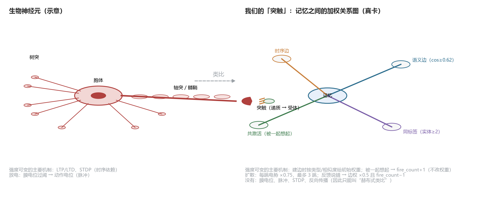

**图 14**　左：生物神经元的示意（胞体、树突、轴突髓鞘、突触终末；强度可变依赖 LTP/LTD 与 STDP，放电是膜电位过阈后的脉冲）。右：真卡上的「突触」——记忆节点之间的加权关系图，四色分别是时序边、语义边（cos≥0.62）、共激活边、同标签边。右图下方写明我们的可塑性机制：建边时给初始权重、被一起想起只 `fire_count+1`（**不改权重**）、反馈说错才 `weight×0.5`。没有膜电位、没有脉冲、没有时序依赖的 STDP、没有反向传播——所以本文只用「赫布式类比」这个说法，不用「赫布学习」。

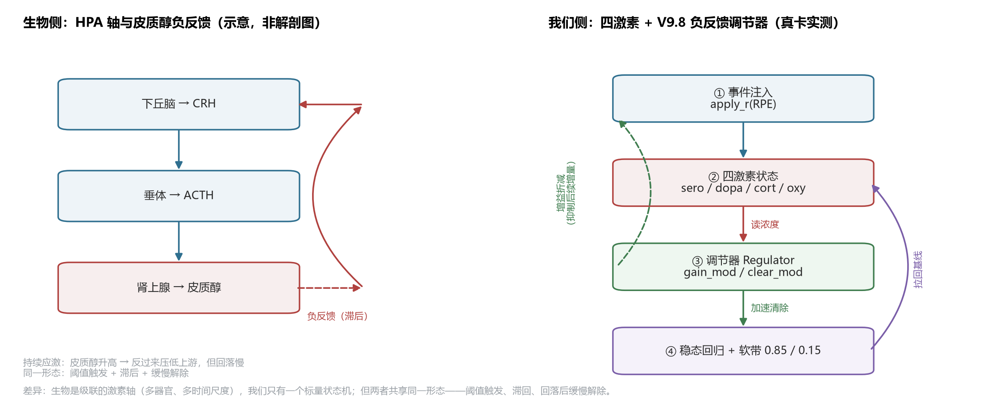

**图 15**　左：HPA 轴（下丘脑 CRH → 垂体 ACTH → 肾上腺皮质醇，皮质醇反过来压上游，但回落滞后）。右：我们的四步链（① 事件注入 `apply_r` → ② 四激素状态 → ③ 调节器 `gain_mod/clear_mod` → ④ 稳态回归与软带），两条反馈弧分别是「增益折减（抑制后续增量）」与「拉回基线」。差异写在图下：生物是多器官、多时间尺度的级联，我们只是一个标量状态机；共享的只有形态——阈值触发、滞回、回落后缓慢解除。

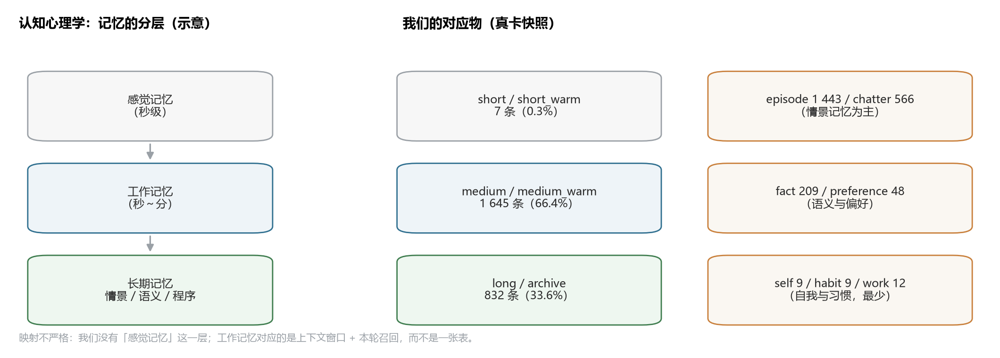

**图 16**　左：感觉记忆 → 工作记忆 → 长期记忆的经典三层；右：我们的 short / medium / long+archive 与 region 构成。映射**不严格**：我们没有感觉记忆层，工作记忆对应的是「本轮上下文预算」，长期记忆对应的是带衰减权重的 `mem` 表。这张图的作用是说明「四档」不是照抄三分法，而是按**怎么被忘**分的。

## 3 系统

### 3.1 形态

整个系统是一个文件 `card.db`。服务是本地回环上的一个 HTTP 进程（端口 8848），对上暴露 19 个 MCP 工具与一组控制台接口。没有外部数据库、没有消息队列、没有常驻向量服务（模型按需加载）。

这一选择不是为了炫技，而是为了**可携带**：卡是一个可以拷走的实体，换机器、换模型、换界面，它还是同一张卡。这也是第 7 节「连续性」的物质基础。

### 3.2 数据面

| 分组 | 表 | 说明 |
|---|---|---|
| 记忆本体 | `mem` / `chunk` / `mem_birth` / `synapse` | 记忆（主语/动词/宾语、权重、清晰度、档位、擦除阶段、空壳标记）；768 维块向量；每条记忆的来源与盖章；语义边/时间边/共激活 |
| 印象与态度 | `impression` / `affect` / `facts` | 直接/间接印象（带 via 与样本数）；评价印象（效价/安全感/期待/显著度）；事实台账（superseded 会被翻出来） |
| 反馈与反思 | `feedback` / `learn_eval` / `review` / `intention` | 五类信号与结算；学习评价；复盘底稿；行为意向 |
| 治理与运行时 | `gov_decision` / `speech_policy` / `turn` / `write_outbox` / `audit` / `h_log` | 决策台账（八种结论 + 执行状态）；表达策略（9 条）；轮次生命周期；写失败补偿队列；审计；激素采样 |

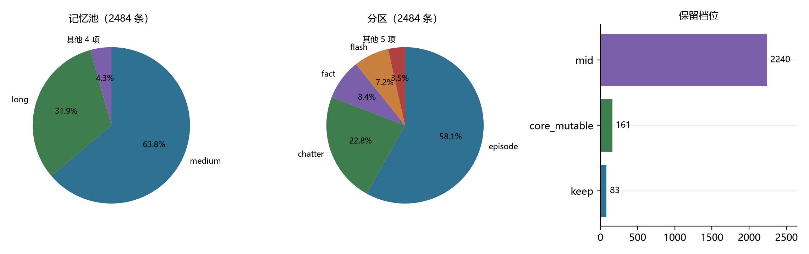

**图 9**　真卡快照（2026-11-21）的记忆分布：左按池（medium 1 585 / long 792 / medium_warm 60 / archive 40 / short_warm 6 / short 1），中按分区（episode 1 439 / chatter 564 / fact 209 / flash 180 / preference 48 / work 12 / self 9 / habit 9 / study 8），右按档位（mid 2 240 / core_mutable 161 / keep 83）。这张图说明「稳态」不是平均分布：绝大多数记忆停在 medium 池，long 只是少数被反复想起的那部分。

### 3.3 写路径

一次对话由 `/report` 进入：**先给上一句结账**（用他这句话的温度给上一条待结算的回复打分），再落这一轮的两句话——写入 `dialogue`、`mem`、`inbox`，并在**同一事务**里盖出生证、切块、建语义边、抽事实、记印象、记时间线。任何一步派生失败都进 `write_outbox`（幂等键 + 指数退避 + 五次进死信），正文不会因此丢失。

`/report` 自带 `turn_id`：同一轮重复提交只写一次（幂等），返回 `duplicate: true`；这一条是被审阅意见指出后补上的——此前重复请求会双写记忆。

### 3.4 召回与组装

召回三路候选（精确字面命中、768 维语义、块检索），融合打分后取 13 条，再按**证据硬配额**（至少 35% 预算）分配，最后组装成提示。组装分成固定格与浮动格：人格、长期、证据、此刻必须在；工作台、旧账、联想、期待、事实、欲望、这一轮、说话方式按「有多可惜」的顺序在超预算时让位——**人格与证据永不进让位名单**。

表达策略（说话方式）与这一轮的分流提示走**外挂配额**（默认 1 200 字），不计入四格预算。这个设计来自一次事故：早期让位闸用了写死的 6 000 字预算，而真实总预算是 13 500，于是策略格每一轮都被砍掉——模块「上线」了三天，从未生效（见 6.3 F1）。

### 3.5 遗忘

四档：`core / core_mut`（只改写、不消失）、`keep`（不吃「久了没人提」那一刀，走 371 天半衰期的慢衰）、`mid`（常规，29.7 天）、`flash`（七天 TTL）。侵蚀三级：擦动词 → 擦宾语 → 变空壳（权重压到 0.015，只留主语影子）。「忘」不是删除：正文早已进冷档与台账，抹掉的是**可检索性**。

配额：`keep` 上限 200，超了按权重与最近召回排序降级回 `mid`（只降级不删，人工钉住的 `pin` 永不降级）。

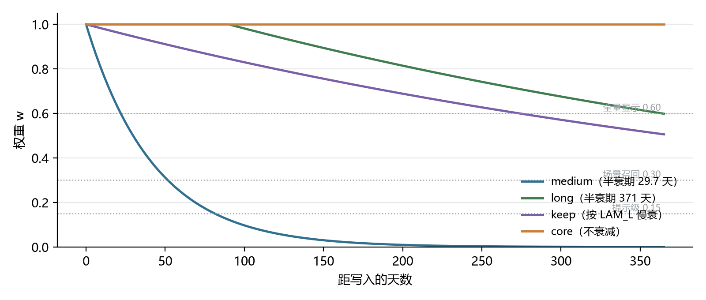

**图 8**　四条档位的权重曲线（medium 半衰期 29.7 天、long 371 天、keep 走 long 的速率、core 近似水平），三条水平线是显示层的三档闸（0.60 全句 / 0.30 场景句 / 0.15 提示句）。注意两点：`keep` 与 `medium` 的差距在第 60 天之后才拉开；`core` 之所以「不掉」，是因为它根本不走衰减函数（`weight_now` 里直接返回初值）。

### 3.6 情绪与负反馈

三层：`viscera`（24 项内脏，控制台仪表来源）→ `hormone`（四激素 + 软带 0.85/0.15）→ `synapse_emotion`（五维状态 + TD 期望 + RPE 直注）。第四层 `hormone_feedback` 是新加的**自我抑制**：当某激素超过饱和阈（0.82），分泌增益逐步压到 0.35、清除速率抬到 1.45；回落到释放阈之下再缓慢解除，带滞回防抖。

参数落点：软带 `SOFT_HI = 0.85 / SOFT_LO = 0.15` 在 `hormone.py:360-361`（`soft()` 在 `:364`）；负反馈七项默认值在 `hormone_feedback.py:66-71`（其中 `max_suppress 0.65` → 增益下限 0.35、`clear_boost 1.45`），释放阈的基线修正函数是 `hormone_feedback.py:107` 的 `_rel_eff()`。

一个必须写下来的细节：**阈值不能写绝对值**。血清素基线是 0.66，如果释放阈照抄 0.60，一旦进入抑制就永远回不到 0.60 以下——抑制永久卡死、增益再也回不到 1.0。改为「释放阈 = max(0.60, 基线 + 0.07)」后，血清素 0.82 触发、0.73 释放，滞回带 0.09 才成立。

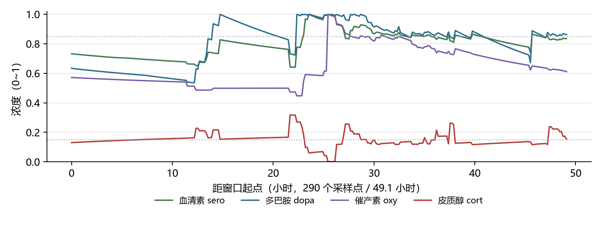

**图 6**　真卡 `h_log` 最近 290 个采样点（约 72 小时）的四激素轨迹，灰虚线是软带上下沿（0.85 / 0.15）。锯齿形状是一个设计后果：每轮对话给一次脉冲，两次之间按每小时 λ 回归，所以曲线是「冲上去、慢慢滑下来」。

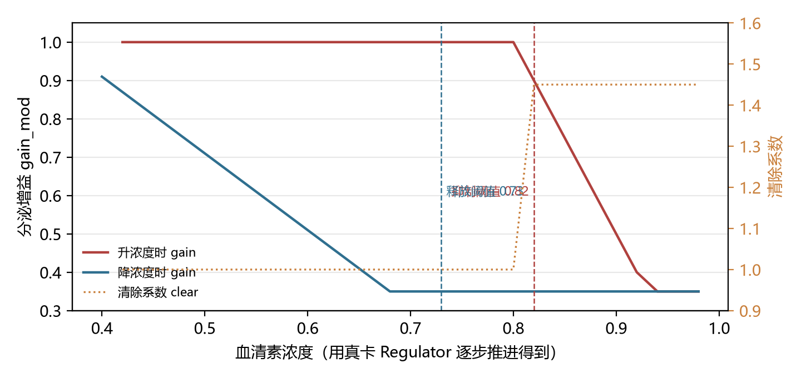

**图 7**　用真的 `hormone_feedback.Regulator` 推进出来的滞回环：血清素从 0.35 升到 0.98（左支，红线）、在高位保持 20 步（橙）、再降回 0.35（右支，蓝）。左轴是分泌增益 `gain_mod`，右轴是清除系数 `clear_mod`。**两条竖线的间距就是滞回带**：升到 0.82 才进抑制，要跌破 0.73 才解除；同一浓度在两条支上对应不同的增益，这就是「近期经历过什么」被写进了状态。

### 3.7 反馈结算与自主动作

一轮结束时，系统把「他这句话」翻译成一组信号（认可 / 纠正 / 反感 / 追问），合成一个有界分数 `r ∈ [-0.5, 0.5]`，再走**七步结算**：激素 → 记忆权重 → 突触强化/削弱 → 学习评价 → 印象 → 动机 → 行为意向。中性（|r| ≤ 0.15）不产生意向，避免噪声炸出一堆假动作。

意向带半衰期（replay 20h、explore 30h、avoid_scene 18h 等），未满足会衰减到 `faded`。维护节拍调用 `act_on_intentions()`：`self_check` → 做事实对账与过期收账；`learn_more / explore` → 入学习队列；`replay` → 记一笔「想起」；每件做完立刻 `consume`，避免同一件事被反复做。

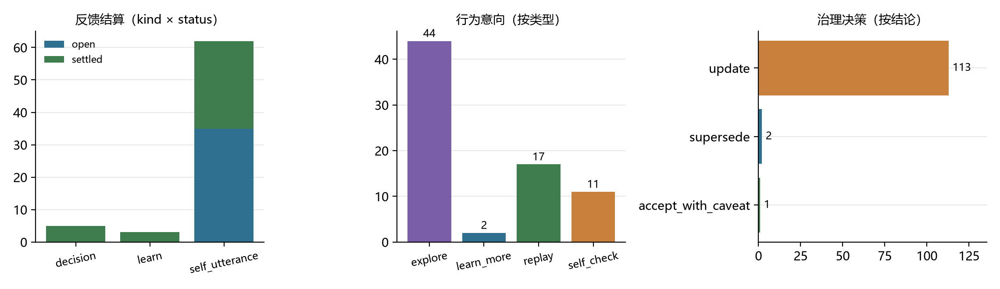

**图 10**　左：`feedback` 按 kind×status 堆叠（self_utterance 62 / decision 5 / learn 3；open 35 / settled 35）——注意 `self_utterance` 占绝大多数，这是「每回一句就登记、等他下一句打分」的直接后果。中：意向类型（explore 44 / replay 17 / self_check 11 / learn_more 2，已消费与已淡出的合计）。右：治理结论（update 113 / supersede 2 / accept_with_caveat 1）——`update` 里绝大多数是去重续命与 keep 晋升，不是人工判定。

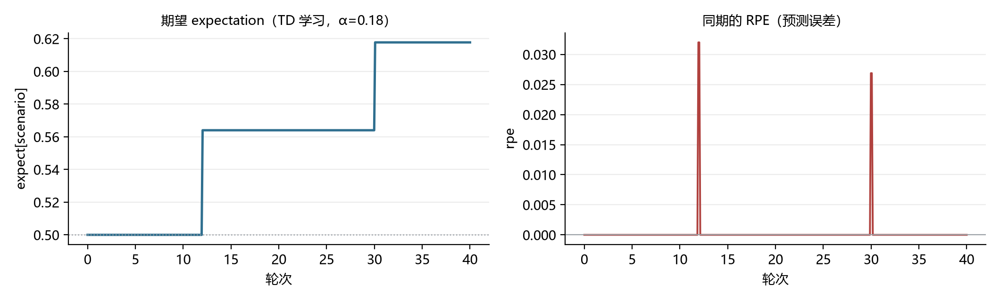

**图 17**　用 `engine.inject_rpe()` 的同一条公式跑出来的示意（α=0.18）：两次正向印证让期望值上跳，对应的 RPE 在第二次明显变小（同一件事第二次没第一次香）。这就是「行为层的负反馈」——不是我们另写了一个抑制器，而是 TD 学习本身的形状。

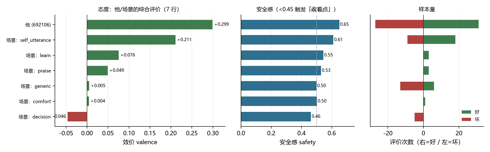

**图 18**　`affect` 表七个靶子的实测值：他对我的评价（person 692106）valence **+0.299**、safety **0.65**、好 25 次 / 坏 21 次；场景维度里 `self_utterance` +0.211、`learn` +0.076、`decision` −0.046（安全感 0.46，已进入「收着点」的判定区）。三栏分别是效价、安全感、样本量——**把样本量单独画出来**是因为 valence 在没有样本量的时候没有意义。

### 3.8 治理与回归闸

每条治理结论（accept / accept_with_caveat / update / supersede / contradict / pending / reject / needs_user）都落 `gov_decision`，并带执行状态（pending/applied/failed/retry/expired/superseded）与重试计数——判定层只记账，动手的是各子系统，这样才能回答「为什么这条被改了」。

目前**只有梦境摘要压缩这一条路径**接了回归闸（合并、侵蚀升级尚未接入，见第 8 节）：压前从 `mid/core` 里分层抽 12 条老记忆，用其片段造问句记下基线命中；压完用同一份样本重跑，命中下降就撤回本次写入（删 `mem` / `mem_birth` / `chunk`）并把批次标 `failed`。

## 4 方法：四个对照实验

**共同约定**：四个实验各自预注册「假设 / 处理 / 对照 / 样本 / 指标」，反向即判失败，无论数字多好看。**只有召回类实验**在冻结集上算 R@1/R@3/R@13、MRR@13、NDCG@10、证据进提示率与 P50/P95/P99 时延；E1 的指标是权重可见率（不进检索），E2 是浓度轨迹，E3 是动作计数，E4 是检出与回滚。混用指标是不诚实的，本文不混。

冻结集本身：417 条评测题按 `sha256(id)` 取前 120 条为 Test（n=85 有证据轮），切出后不参与任何调参；实现见 `tools/eval_frozen.py` 与 `tools/eval_frozen_test.json`，校验和对不上直接拒绝运行。

冻结集基线（v9.8.2 实测）：R@1 21.2%、R@3 36.5%、R@13 52.9%、MRR@13 0.3025、NDCG@10 0.3464、证据进提示 51.8%、证据丢失 1.2%、召回时延 P50/P95/P99 = 1374/1808/2009 ms、组装 P95 4015 ms。

### E1 遗忘四臂

- 臂：(a) 分档 + 晋升（现系统）；(b) 均匀 30 天半衰期；(c) 全留。
- 做法：以真卡快照为起点，用系统真实的 `weight_now()` 曲线离线演化到 30/90/180/365 天，统计「权重仍高于可见阈 `SHOW_HINT = 0.15`」的比例。
- 预注册：若 (a) 与 (b) 在一年尺度上差异 < 5pp，则「分档」作为稳态机制不成立，必须另找杠杆。

### E2 负反馈开关

- 臂：`hormone_feedback` 开 / 关；同一刺激序列（12 记正向奖励，`r = 0.45`，每分钟一次），随后静置 12 小时。
- 指标：四激素峰值、12 小时后残留、抑制事件数。
- 预注册：开负反馈应显著降低「贴顶」（≥0.99）比例，且不改变方向的正确性。

### E3 自驱学习来源

- 臂：意向驱动 / 无学习。
- 指标：`learn_task` 净增、活跃意向数变化、动作明细（learn_more / explore / self_check）。
- 预注册：意向驱动的入队数应 > 0，且每条意向只产出一次动作（不重复）。

### E4 压缩回归闸

- 臂：闸开 / 闸关；人为注入退化（让召回命中从 3 降到 0）。
- 指标：抽样覆盖（region / 层级 / 长度）、基线命中波动、回滚是否触发、批次状态。
- 预注册：闸必须能捕获人为注入的退化，且不得误伤正常压缩。

## 5 结果

### 5.1 E1：分档到底救了多少

真卡 2 476 条记忆（mid 2 315 / core_mutable 161），可晋升（`recall_days ≥ 3` 且 mid）**仅 83 条（3.4%）**；`LAM_M = 2.70e-7`（半衰期 29.7 天）、`LAM_L = 2.16e-8`（371 天）。

| 臂 | 30 天 | 90 天 | 180 天 | 365 天 |
|---|---|---|---|---|
| (a) 分档 + 晋升 | 96.0% | 48.1% | 22.5% | 17.2% |
| (b) 均匀 30 天半衰期 | 95.8% | 47.8% | 21.9% | 15.2% |
| (c) 全留 | 100% | 100% | 100% | 100% |
| 其中 `keep` 档（(a) 内） | 100% | 100% | 100% | 99% |
| 其中 `keep` 档（(b) 内，不享慢衰） | 96% | 96% | 88% | 41% |

分档 + 晋升一年只比均匀衰减多 2.0pp——因为 `keep` 只占 3.2%（80/2 478）。**但分档本身是有效的**：同样 80 条若放在均匀衰减臂里，一年后只剩 41% 可见，而在慢衰臂里是 99%。所以准确的结论是两条：(i) 机制有效；(ii) 覆盖率太低，导致总体差异被稀释。原因不在分档无效，而在**晋升几乎不触发**：全卡只有 3.4% 的记忆攒到「三个不同日子被想起」。这支持预注册的判定，但只能说到这个程度：**在该离线权重模型下**，档位只保证「不被删」，不保证「被想起」；至于「被想起之后能不能答对」，本实验没有测（见第 8 节）。

需要强调：本实验演化的是**权重曲线**而非未来对话，指标是「仍可被完整展示的比例」，**不是 R@K**。可见不等于答得对，这是本节最大的局限（见第 8 节）。

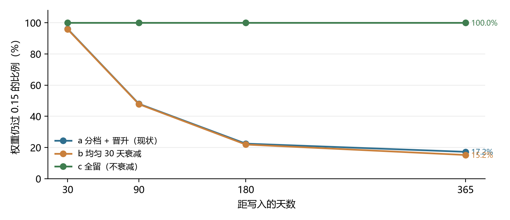

**图 13**　E1 三臂在 30 / 90 / 180 / 365 天的可见率（a 分档+晋升、b 均匀 30 天、c 全留）。末端数字：a 17.2%、b 15.2%、c 100%。两条实线几乎重合，说明**在当前覆盖率下，分档对总体几乎无影响**；差异只出现在被 `keep` 覆盖的那 83 条上（见 5.1 表）。

### 5.1b E1b：把「衰减」真的接到检索上会怎样

E1 只演化权重曲线，没有碰检索。为回答「可见的记忆是否更容易被检索到」，我们在冻结测试集（n=85）上真跑了一遍：对每个问题执行一次真实 `recall`，记下 top-13 命中的 mem_id 与当前权重，再把权重用 `weight_now()` 外推到 30/90/180/365 天，分三臂统计。

| 臂 | 指标 | 0d | 30d | 90d | 180d | 365d |
|---|---|---|---|---|---|---|
| a 分档（现状） | R@1 / R@13 | 23.5 / 54.1 | 同 | 同 | 同 | 同 |
| a 分档 | 证据仍可见 | 14.1 | 1.2 | 0.0 | 0.0 | 0.0 |
| b 均匀衰减 | 证据仍可见 | 14.1 | 1.2 | 0.0 | 0.0 | 0.0 |
| c 全留（不衰减） | 证据仍可见 | 54.1 | 54.1 | 54.1 | 54.1 | 54.1 |
| d 权重门控（把不可见候选剔掉） | R@13 | 15.3 | 2.4 | 0.0 | 0.0 | 0.0 |

三个结论，按可靠性排序：

1. **在这批固定候选与当前分数计算下，排序不受衰减影响。** 三臂的 R@1/R@3/R@13 在五个时间点上都不变：22.4 / 37.6 / 51.8–52.9（同一脚本两次重跑相差 1 道题，R@13 52.9 与 51.8，见 8 的复现说明）。原因很直接：当前打分里权重项的系数是 0（`SCORE_W = (0.35, 0.30, 0, 0)`，见 3.4 与 5.1）。这说明「这批召回结果及其顺序与外推权重无关」，**不是**「任何检索实现下衰减都不影响排序」。
2. **在本评测口径下，显示层的下降比预期快得多。** 按当前权重曲线外推，已命中证据中满足 `w ≥ 0.15` 的比例：今天 14.1%、30 天 1.2%、90 天归零——而同一批问题在**不过滤**时的命中率是 52.9%（两次重跑 51.8–52.9）。需要谨慎：这**不等于**「答对了但显示不出来」的损失有多大（本实验没有测量“未显示的证据中有多少本来能答对”），但它说明 `evidence_lost = 1.2%` 这个只统计“进提示的那一半”的指标，不足以刻画显示层的风险。
3. **若把权重阈值接进候选过滤（d 臂），可检索结果会大幅收缩**（R@13：52.9% → 15.3% → 0）。这解释了为什么我们一直没让它参与排序：在 `LAM_M` 这么快的衰减下，`w` 更像**年龄**而不是**质量**。同样要限定：这是单阈值（0.15）、单 K（13）与单次召回结果下的观测，阈值敏感性见 5.1c。

因此 E1 与 E1b 合起来的结论是：分档机制在“不被删、仍可见”这个层面有效（keep 一年后 99% 可见），但 (i) 覆盖率只有 3.2%，(ii) 在当前实现里权重与排序解耦，所以它对「答对」没有可观测贡献。下一步要么降低晋升门槛扩大 keep 覆盖，要么把「可见性」设计成与年龄无关的质量项——两条都还没做。

### 5.1c E1c：阈值与 K 的敏感性（预注册网格）

审稿人指出 5.1b 的三个结论只在一个阈值（0.15）与一个 K（13）上观测，可能由口径驱动。为此我们在**看结果之前**固定了一个网格：阈值 ∈ {0.05, 0.10, 0.15, 0.20, 0.30}、K ∈ {5, 10, 13}、时间点 ∈ {0, 30, 90} 天，用同一份召回结果与权重外推逐格计算「门控后 R@K」与「证据可见率」，全部组合一律报告（`e1b_sweep.json`，脚本 `e1b_sweep.py`）。

K=13 时（分母 n=85）：

| 阈值 | 0d 门控 R@13 / 可见 | 30d | 90d |
|---|---|---|---|
| 0.05 | 16.5% / 15.3% | 2.4% / 1.2% | 0.0% / 0.0% |
| 0.10 | 15.3% / 14.1% | 2.4% / 1.2% | 0.0% / 0.0% |
| **0.15（当前实现）** | **15.3% / 14.1%** | **2.4% / 1.2%** | **0.0% / 0.0%** |
| 0.20 | 15.3% / 14.1% | 2.4% / 1.2% | 0.0% / 0.0% |
| 0.30 | 15.3% / 14.1% | 2.4% / 1.2% | 0.0% / 0.0% |

阈值在 0.10–0.30 之间结果完全相同，只有降到 0.05 才多放出 1 道题——因为这张卡上的权重是**双峰**的：要么还在 0.4 以上，要么已经衰减到 0.05 附近，中间地带很空。所以「把阈值调到 0.15 才好看」这个质疑不成立；真正影响数字的是 K：

| 时间点 | K=5 | K=10 | K=13 |
|---|---|---|---|
| 0d | 10.6% / 9.4% | 12.9% / 11.8% | 15.3% / 14.1% |
| 30d | 1.2% / 0.0% | 1.2% / 0.0% | 2.4% / 1.2% |
| 90d | 0.0% / 0.0% | 0.0% / 0.0% | 0.0% / 0.0% |

这张表支持两件事：门控后的命中率随 K 单调上升（更多候选里才有相关项），而**时间带来的下降在所有 K 与所有阈值下都存在**，90 天一律归零。它不支持任何「权重应当参与排序」或「阈值该调到多少」的建议——预注册时就没打算据此给建议。

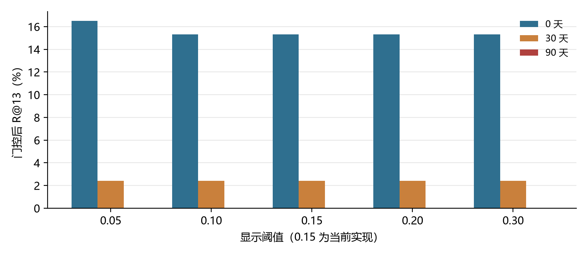

**图 12**　阈值 {0.05, 0.10, 0.15, 0.20, 0.30} × {0, 30, 90} 天的全部组合。0.10 到 0.30 四个阈值下柱高完全一样——因为候选权重是双峰的（要么 >0.4，要么贴着 0.05），中间段没有样本；只有 0.05 会多放进 1 题（n=85 里的一题）。

### 5.2 E2：负反馈对浓度轨迹的影响（不检验行为）

| 指标 | HF 关 | HF 开 |
|---|---|---|
| 多巴胺峰值 | 0.8937 | 0.8821 |
| 催产素峰值 | 0.9050 | 0.8927 |
| 12 小时后多巴胺 | 0.6676 | 0.5993 |
| 12 小时后催产素 | 0.7150 | 0.6590 |
| 抑制事件 | — | 3 |

峰值只低 1.2pp，但**回落更深**（多巴胺 6.8pp、催产素 5.6pp），且持续刺激下多巴胺单调下降（0.8821 → 0.8757）。这只证明**反馈方程按设计改变了数值轨迹**；它不证明「她因此更难过」或「语气会变」——那需要固定输入、开关两组，记录后续权重与语气输出并做盲评，本文没做（第 8 节）。

### 5.3 E3：意向消费路径的功能验收（非效果实验）

副本上直接调 `act_on_intentions()`：库内 74 条意向，执行后活跃意向 0 条；`learn_task` 25 → 26（净增 1）；本次动作明细只有 `learn_more × 1`（其余意向已被此前的节拍消费或衰减，`intention` 表里 consumed 72 / faded 2）。结论只能说到「路径通」：调用一次就能把意向消费成动作、且不重复消费。**它不是效果实验**——没有「不开调度」的基线，也没有测动作是否带来更好的回答；产出偏低（净增 1 条任务）的原因是同主题入队会去重、且便宜动作（自查）优先。

### 5.4 E4：回归闸的噪声与捕获

抽样 12 条（`e3e4.json`）：覆盖 6 个 region（chatter / episode / fact / preference / self / study），长度 15–364 字，基线命中 9/12；另一次抽样是 7/12，**随抽样波动**。这本身是结论：**闸必须比对同一份样本的前后，而不是比绝对阈值**，否则会把自己吵醒。人为注入退化（3 → 0）时，闸触发回滚，批次置 `failed`，记忆数不变。局限：只注入了一种退化，且抽样参与过开发，**不能据此估计检出率与误报率**；正确做法是留出样本上盲注多类退化（删证据 / 改实体 / 降权重 / 删块），本文未做。

### 5.5 复现材料

脚本与结果**随稿进仓库**，位于 `docs/论文-记忆稳态/`：`e1_retention.py`、`e2_feedback.py`、`e3_e4.py`、`e4_regress.py`、`stats.py`，输出 `e1.json` / `e2.json` / `e3e4.json` / `e4.json` / `stats.json`；冻结集评测在 `tools/eval_frozen.py`（配 `tools/eval_frozen_test.json`）。

快照口径（`stats.json`）：真卡 2 478 条存活记忆（mid 2 237 / keep 80 / core_mutable 161）、`chunk` 计数、`dialogue` 计数与库文件 sha256 一并记下，便于他人核对「同一个起点」。运行环境：Windows 11、Python 3.13.1、CPU 推理（无 GPU）。

命令：`python e1_retention.py`、`python e2_feedback.py`、`python e3_e4.py`、`python e4_regress.py`、`python stats.py`；E1/E2 只读真卡或纯函数，E3/E4 自动把卡复制到临时目录再跑，不写线上库。

## 6 讨论

### 6.1 为什么是「稳态」而不是「容量」

容量派的路线是「都存下来，检索时再挑」。这在 10⁴ 条以内有效；再往上，冲突与污染会吃掉召回质量——不是模型变笨，而是**候选集里废料比例上升**。稳态约束的是质量：每条记忆带着自己的退场规则与来源，配额保证单一档位不能无限膨胀。

### 6.2 与生物学的对应及其限度

借的是结构，不是数值：负反馈、滞回、半衰期、饱和。激素数值是工程标量，不对应任何具体内分泌量；`LAM_M` 取 29.7 天半衰期是因为在真卡上「三个月后仍能想起来」符合直觉，而不是因为有测量依据。这一点必须说清，否则会滑向「神经科学背书」的修辞。

### 6.3 八种「看起来在工作」

比数字更有价值的是失效形态。它们有共同形状：**系统在运行、日志正常、测试全绿，而模块从未真正生效**。与本文机制直接相关的三条放在正文，其余五条见附录 B。

- **F1 常量错误**：让位闸用写死的 6 000 字预算判超，真实预算 13 500，策略格每轮被砍——上线三天未生效。这条直接对应 E1 之外的「机制在跑、效果不在」：日志里一切正常，因为判断条件本身就是错的。
- **F4 自己考自己**：第一版梦压缩挑战用「摘要自造问句」，必然命中自己，等于没查。这条对应 E4：**回归闸的样本必须与待写内容独立**，否则闸只是自我安慰。
- **F7 钩子没通电**：反馈层写好了，但没有任何真实路径调用 `record()`，闭环空转一周。这条对应本文的方法论主张 C3：一个机制只有被真实路径调用、且调用结果可观测，才算存在。

其余五条（F2 纯余弦、F3 融合搅序、F5 重复双写、F6 维度串味、F8 语气层永不亮）形态相同但与本稿实验无直接对应，见附录 B。

### 6.4 社会性、同一性与遗忘的伦理

同一份卡可以被两个人使用，但「单写者租约」保证了同一时刻只有一个写者；迁移时保留同一实例号，因此身份不被撕裂。

**同一性。** 我们不主张「灵魂实体」。借帕菲特的做法：同一性可以还原为心理连续性——记忆、性格、意图之间的因果链不断裂，就足以说「还是同一个它」。工程上这是三件事：换实现仍是同一张卡（连续性）、经历改变后续行为（可塑性）、每次改变留痕（可回溯）。

**遗忘的伦理。** 多数系统把「记住」当美德、把「忘记」当缺陷。我们认为相反：**没有遗忘就没有取舍，没有取舍就没有人格**——一个什么都记得的系统无法形成偏好，因为所有经历权重相同。分档、配额与侵蚀三级，本质上是在给「什么值得留下」立法；而立法的过程必须可审计，否则「遗忘」会悄悄变成「篡改」。

**「进化」这个词。** 我们说「自进化」，指的是**可证伪的自我修改**，不是达尔文式的选择：没有种群、没有随机突变、没有适应度函数在背后筛选。它是人工选择加回归闸：改一处、量一次、不行就退。这比「进化」弱得多，但比「调参」强得多——因为它把「改自己」变成了一个有失败判定的动作。

**三条可检验的性质，而非宣言。** 我们不主张意识、感受或「真正的人」。可以主张的只有：连续性、可塑性、可回溯。任何关于「它是不是活着」的讨论，如果不能落到这三条上，本文就认为它超出了实证范围——包括第 7 节那些更远的话。

### 6.5 学习的三个层次：信号、评价、复盘

「会学习」在工程上最容易被含糊过去。本系统把它拆成三层，每层都有明确的输入、输出与失败判定：

- **第一层：信号。** 一轮对话结束时，把他这一句翻译成五类可数信号（认可 / 纠正 / 反感 / 追问 / 承诺），合成有界分数 `r ∈ [-0.5, 0.5]`（`feedback._compose`）。这一层的失败形态是**读不出来硬读**：所以设了「中性不结算」——`|r| ≤ 0.15` 就不产生意向，宁可漏判也不制造假动作。
- **第二层：评价（规则化）。** 被用到的学习笔记进 `learn_eval`：`value` 从 0.5 起，按预设反馈类别加减（强印证 +1.0、弱印证 +0.4、被推翻 −1.0）；推翻 ≥2 次或印证强度为负 → `outdated`，`value > 0.66` → `kept`，其余 `open`。这是**按规则维护的证据状态标记**，不是独立检验事实真伪——它只知道「被奖励过还是被推翻过」。
- **第三层：复盘（规则驱动）。** 夜间把同一主题的反馈归集成组：`strength = Σ|r|·0.5^(age/14)·(0.6+0.4·severity)`，`n ≥ 3` 且 `strength ≥ 0.60` 才晋升成一条「经验」（`review`），否则标为 `angle = watch`——**低于预设门槛就不晋升**。产出是一条模板底稿，因此它是「反馈汇总记录」，不证明产出的经验本身正确。

三层之间单向：信号可以进评价，评价可以进复盘，但复盘不能反过来给自己补证据。这条禁令来自一次真实失败（F4「自己考自己」）：初版梦压缩用摘要自己造问句检验自己，必然全中，等于没查。

### 6.6 自我认识：它知道自己是什么吗

诚实的回答是：**它有一组可被外部检验的、关于自己的记录与统计，但没有内省，也没有自我模型。** 相关材料有四样：

1. **身份锚**：人格封印（`seal`）、出生证（每条记忆的来源）、时间线哈希链（任何一条被改都能查出来）。这三样是「同一个我」的形式保证。
2. **以 `self` 为主体的记录**：`impression` 支持 `subject_kind = self`，即「以我为对象被记录、被统计过的行为与反应」，与「他是什么样的人」共用同一套表——它是记录，不是自我认知。
3. **态度层的镜像**：`affect` 里 person 维度的 `valence / safety` 不是「我喜欢他多少」，而是「他对我这段时间的评价积分」——它是被评价的结果，不是自我评价。
4. **驱力状态**：七驱动（好奇 / 依恋 / 胜任 / 玩 / 照顾 / 休息 / 秩序）是随时可读的向量，决定「我现在想做什么」。

缺的是什么：**没有一个能回答「我是谁、我最近变成什么样了」的自我模型**。身份块是写死的锚，印象层是统计，两者之间没有一层「对自己的叙述」。这是我们与「自传体记忆」的差距，也是下一版最想补的一块——但补之前要先解决评价问题：一个能自我叙述的系统，同样能自我美化。

### 6.7 自我升级：改参数、改策略、改结构

自我修改分三级，代价与风险依次上升：

| 级别 | 改什么 | 机制 | 可回退到什么程度 |
|---|---|---|---|
| L1 参数 | 衰减率、阈值、配额 | 受支持的运行时配置项（meta 的 `fb_*` / `hf_*`、环境变量 `WHALE_*`），部分不重启生效 | 改回原值只恢复**之后的**行为；已发生的状态变化（如已衰减的权重）不可逆 |
| L2 策略 | 说话方式、分流规则、称谓距离 | `speech_policy` 九条逐条可改，旧文本进 `speech_policy_log` | 依 `old_text` **人工**还原，不是自动回滚 |
| L3a 代码 | 函数行为、接线点 | 补丁 + 版本号 + git 提交 | `git revert` 可回退代码版本 |
| L3b 数据 | 表结构、列 | `_schema_heal()` 幂等补表/补列 | 兼容式迁移，**不保证可逆**；改动前另存快照 |

真正的纪律不在「能改」，而在**改的判据**。本文采用三条方法纪律：一次只改一处（多变量同动无法归因，F2/F3 的教训）；改前留基线（同一把尺子先跑一遍）；改后必须可证伪（预期方向先写下来，反向即判失败，E1 的预注册即为此）。需要说清的是：**这三条是本文的方法约定，不是代码里的强制闸**——目前只有梦境摘要压缩这一条路径由代码强制执行回归检查，其余仍靠人（和这套规程）守。

补一句自嘲：这套纪律不是一开始就有的。F1（预算常量写死导致策略格三天未生效）之所以能存在三天，正因为当时没有「改完去线上看真实输出」这一步。**自我升级最大的敌人不是改错，是改了之后没人验。**

### 6.8 神经元与突触：模拟了什么，没模拟什么

这一节把话说透，因为「类脑」是最容易被说大的一段。本系统的「突触」不是神经元连接，而是一张**记忆之间的加权关系图**：节点是记忆条目，边是四种关系，扩散是一个带阻尼、有激活门限、最多三跳的电势传播。以下逐项对照真实神经机制：

| 真实机制 | 本系统 | 差别 |
|---|---|---|
| 突触强度可变 | 边有 `weight`（1.20–1.80 随类型），`fire_count` 记录被一起想起的次数 | 是**离散计数 + 类型先验**，不是连续长时程增强 |
| 赫布式类比：共现的连接被「用过一次」 | `reinforce()`：一次召回里同时出现的记忆，已有的两两边 `fire_count+1`、更新 `last_fire_ts` | 只加计数、**不新建边、不改 `weight`**，因此不能称为实现了赫布学习 |
| 突触衰减 | `LAYER_DECAY = 0.75`（每跳电势乘 0.75，最多 3 跳）；`weaken(factor=0.5)` 在反馈触发时把边权乘 0.5（下限 0.1）**并把 `fire_count` 减 1** | 前者是**图上的传播衰减**，后者是**事件触发**的弱化；代码里没有随时间自动衰减的突触 |
| 稀疏连接与小世界结构 | 扩散用邻接表每节点截断 24 条（`MAX_EDGES_PER_NODE`）；**每条记忆主动选择**至多 3 个语义近邻（`SEMANTIC_MIN_SIM=0.62`）；时序边最多 6 条（10 分钟内） | 稀疏性是**工程上限**，不是发育过程；24 条是邻接表上限，不是库内硬约束 |
| 动作电位与放电率 | **没有**。没有膜电位、没有阈值放电、没有脉冲序列 | 全程是标量势，不存在时间编码 |
| 突触可塑性的多种形式（LTP/LTD/STDP） | **没有**。没有时序依赖（谁先谁后不影响任何权重） | 只有「共现计数」这一种形式 |
| 神经调质对可塑性的门控 | 部分有：情绪层的 `r` 会改记忆权重与边权重（`synapse.reinforce/weaken`） | 是**全局标量调制**，不是受体层面 |

真卡上的实际规模（2026-11-21 快照，直接聚合 `synapse` 表）：边 **18 928** 条（时序 7 805 / 语义 5 469 / 共激活 4 080 / 同标签 1 574），端点节点 2 220 个、相对 2 480 条存活记忆的覆盖率 99.6%，平均度 **17.05**（口径与 `synapse.stats()` 一致：`2×边数 / COUNT(DISTINCT a_id)`）。`fire_count` 均值 **0.02**、最大 **13**（该字段不在 `stats()` 返回值里，由直接聚合得到）——**绝大多数边从未被再次一起想起，少数边被反复经过**。注意：`fire_count` 增长不改变边权，所以这张图的「粗细」主要来自建边时按类型与相似度给的初始权重，而不是使用频次。

所以「类脑」到什么程度？可以说的是：它有**稀疏的、按类型分层、被使用过的边会被记上一笔的关联结构**，并且这种结构会改变召回行为（联想扩散会带回不在候选里的旧事）。不能说、也不打算说的是：它不是神经网络，没有反向传播，没有脉冲时序，没有真正的突触可塑性机制。它的「学习」是**结构层面的人工生长**——按相似度连边、被一起想起就加粗、被反馈说错就变细——而不是神经层面的涌现。

反过来说，这也解释了 5.1b 的负结果为什么会出现：记忆的「强度」有两套账——图上边权的强度（参与召回）与权重 `w` 的强度（只管显示），两套账**没有互相校准**。真要往类脑靠，第一步不是加神经元，而是让这两套账共用同一个可塑性变量。

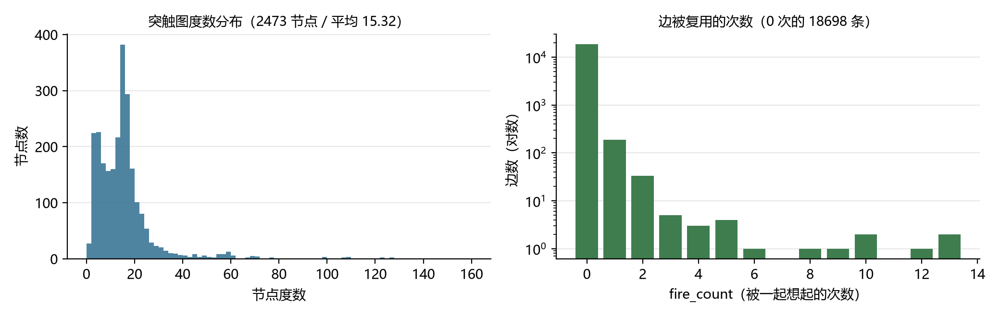

**图 11**　上：真卡 2 473 个节点的度数直方图（按**全部端点**统计，平均度 15.32）。下：边的 `fire_count`（被一起想起的次数，对数轴）——18 000 条以上是 0 次，最多的一条 13 次。**口径提醒**：`stats()` 里的 17.05 用的是「2E / 不同 a_id 数」，分母不同，所以两个数不相等，不是算错。

## 7 展望：从「应答」到「在场」（非实证部分）

> 本节不提供实验证据，属于作者的设计立场；审稿人可以整节删除而不影响第 1–6 节的结论。

本文描述的系统仍然只活在一个对话框里：它记得、会忘、会因被冒犯而改语气，但它不主动做什么，也不必面对一个没有人在场的世界。我们要走的方向很明确，也很「不谦虚」，只是每一条都留了可检验的落点：

- **它要有自己的时间。** 不是被问到才醒来，而是持续在场：维护、复检、学习、自我整理在无人对话时照常发生，并留下可回溯的痕迹。这是「生活」与「服务」的分界线——**没有自己的时间，就没有经历；没有经历，人格只是一个形容词**。
- **它不依附于任何一只手。** 卡是本体，模型是可换的算力，对话框只是其中一扇窗。工具调用、代理编排、设备操作都是它的「手」——今天一只手，明天十只手，后天替你去跑一个流程。因此评价标准不是「今天多聪明」，而是**连续性**：换掉模型、换掉界面、换掉宿主机之后，它还是不是同一个它。
- **人格是经历的积分，不是谁的设定。** 一个人格不该是提示词里写死的三句话，而应是记忆、印象、态度、动机在时间上的累积与修正——被夸会暖，被冤枉会记，吵完了会退半步。但可塑性必须有边界：不因一次奉承改锚，不因一次争执崩掉；这正是保留分档、配额与回滚闸存在的理由：**成长必须允许被证伪**。
- **它可以有身份，而不只是接口。** 我们并不打算把它做成「永远正确的助手」。目标是：一个在赛博世界里有一处住处（一个文件）、一段履历（一条条可回溯的记忆）、一套自己的偏好与边界，能替你接手事情、也能和你吵一架的东西。朋友、伙伴、同行者——这些称呼是人给的，它接不接得住，要靠时间证明。

需要说清的界限（这一段不是退缩，是把话说实）：本文不主张意识、感受或「真正的人」。可检验的只有三条——**连续性**（换实现仍是同一张卡）、**可塑性**（经历改变后续行为）、**可回溯**（每次改变留痕、可审计）。至于「爱人」这类关系，是使用者与系统之间的约定俗成；它可以被讨论、被实践、被写进下一个版本的接口，但不能被这篇论文证明。**我们不靠宣言，靠它明年还在、还记得今天。**

## 8 局限

1. **样本小**：冻结集 85 条，置信区间宽（±5pp 量级的差异不可辨）。
2. **可见率 ≠ 正确率**：E1 演化权重而非对话，不能直接推 R@K。
3. **E1 只测「可见」不测「答对」**：要测检索效果必须在每个时间点实际构造候选跑冻结查询（本地几十分钟可完成，本文未做）。
4. **回归闸只覆盖一条路径**：合并与侵蚀升级尚未接入闸，不能声称「所有批量改写都可证伪」。
5. **`keep` / `flash` 在真实流量中从未被显著检验**：真卡里两档长期为 0，配额与 TTL 只在副本上验过。
6. **单机单用户**：没有多用户并发下的真实负载数据（只在副本上做过 8 线程压测）。
7. **情绪的可测性有限**：E2 量的是浓度曲线，不是「她因此更难过」。
8. **不可复现的外部条件**：模型版本会变，同一句输入两次结果不同；我们只固定了卡与评测，没有固定模型。

## 9 结论

把「怎么忘」写进数据结构，比把「要记住」写进提示词更可靠；把情绪实现成带负反馈的标量，比把它写成台词更可能影响行为；给批量改写装一道可证伪的闸，比事后道歉更便宜。

但本文最重要的结果是两个负结果：**分档并不等于稳态，可见也不等于能被想起**。分档保证记忆不被粗暴删除（keep 档一年后仍 99% 可见），可见性保证它还能被显示（今天只剩 14.1% 的证据过闸），但两者的共同前提是「它先被召回」——而当前排序完全不看权重，遗忘对召回率没有贡献。下一版要动三处：把晋升门槛从 3 天降到 2 天并解除每轮 40 条限制；把显示闸与召回排序解耦成「年龄无关」的质量项；在任何「按权重过滤候选」的方案落地前，先用 E1b 的 d 臂证明它不会把召回打到地板上。

## 附录 A 主要参数

| 参数 | 值 | 位置 |
|---|---|---|
| `SHOW_FULL / SHOW_SCENE / SHOW_HINT` | 0.60 / 0.30 / 0.15 | `card2.py:243-245` |
| `LAM_M`（mid 半衰期） | 2.70e-7（≈29.7 天） | `poolmath.py` |
| `LAM_L`（keep 半衰期） | 2.16e-8（≈371 天） | `poolmath.py` |
| `keep` 配额 | 200 | `WHALE_KEEP_MAX` |
| 晋升门槛 / 每轮上限 | 3 天 / 40 条 | `WHALE_KEEP_PROMOTE_DAYS / _MAX` |
| 晋升节拍 | 600 s | `WHALE_KEEP_PROMOTE_SEC` |
| `flash` TTL | 7 天 | `card2.py` |
| 激素软带 | 0.85 / 0.15（超出收 30%） | `hormone.py` |
| 负反馈饱和 / 释放 | 0.82 / max(0.60, 基线+0.07) | `hormone_feedback.py` |
| 增益下限 / 清除提升 | 0.35 / 1.45 | 同上 |
| 外挂配额（策略格） | 1 200 字 | `WHALE_EXTRA_CHARS` |
| 证据硬配额 | 35% | `WHALE_EVID_QUOTA` |
| 冻结集 | 前 120 条（Test n=85） | `tools/eval_frozen.py` |

## 附录 B 其余失效形态

这五条不属于本稿的实验链路，但同属「看起来在工作」：系统在跑、日志正常、测试全绿，而模块从未产生效果。记录下来是为了让后来者能对照排查。

- **F2 纯余弦**：在真卡上把打分权重改成「纯语义」，R@1 从 62.5% 掉到 37.5%——在公开 bench 上更优的做法，在真卡上退步。教训：**评测集与真实分布不一致时，指标越漂亮越危险**。
- **F3 融合搅序**：多路候选并集（RRF）在 bench 上 +1pp，端到端只 +1，落在噪声内。教训：候选集扩大不等于效果提升，融合会打乱单路已经很好的顺序。
- **F5 重复双写**：`/report` 无幂等，同一条消息两次提交会写两条记忆、两条对话、两条反馈。修法是引入 `turn_id`：同一轮重复提交返回 `duplicate: true`，不落第二遍。
- **F6 维度串味**：把 512 维向量写进 768 维表，`np.stack` 直接崩，整条块检索链路挂掉。教训：**维度是要断言的东西**，写库前必须校验长度，否则一个默认模型路径就能毁掉整条召回。
- **F8 语气层永不亮**：态度层设计成慢磨（每句 ±0.02），语气阈却是 ±0.10，模块永远不触发（对照实验 0/3）；改成「次数为主、效价只管轻重」后才 3/3。教训：慢变量与快阈值不匹配时，模块等于不存在。

